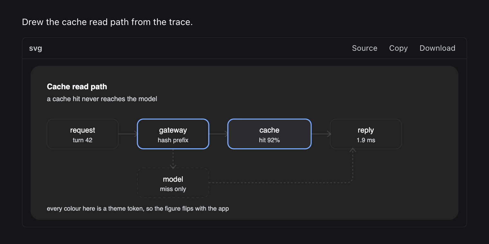

# dsh-svg-fences

[English](README.md) | [中文](README.zh.md)

[](https://www.npmjs.com/package/dsh-svg-fences)
[](LICENSE)
[](https://github.com/chandra447/dsh-svg-fences/actions)



Your assistant wrote an SVG. DSH showed you forty lines of XML.

This plugin shows you the picture, right there in the transcript. It follows the theme, gives you the source back, and adds nothing to your prompt.

```
before                              after
┌──────────────────────────┐        ┌──────────────────────────┐
│ <svg viewBox="0 0 720…"> │        │  request → gateway → …   │
│   <rect x="28" y="90" …> │  ───▶  │  (the actual diagram)    │
│   <text x="88" …>        │        │  Source  Copy  Download  │
│   … 38 more lines …      │        └──────────────────────────┘
└──────────────────────────┘
```

## Install

From the DSH Plugins window, or from a terminal:

```sh
dsh plugin --profile web add dsh-svg-fences
dsh plugin --profile desktop add dsh-svg-fences
```

It is a prebuilt package. Nothing compiles on install, so the `allowBuilds` prompt never appears. Restart or reload the window if the plugin does not show up.

## What you get

- Any fenced block whose text is a complete `<svg>` document renders as a figure under the message, in place.
- `Source` flips back to the code. `Render` flips forward again.
- `Copy` copies the original source. `Download` saves a `.svg` named from the SVG's `<title>`.
- Click the figure to zoom, with +, −, reset. Close with Escape or by clicking the background.
- The figure follows light and dark mode without a reload. Change the theme and it re-encodes itself.
- The rendered figure is an inert `data:` image. No scripts, no external fetches, no network. A fence can draw, it cannot call home.

## Give it a theme

Fences can use short tokens. The plugin resolves them to the values DSH is using right now.

```svg
<svg viewBox="0 0 240 80" xmlns="http://www.w3.org/2000/svg">
  <rect x="8" y="8" width="224" height="64" rx="10"
        fill="var(--surface)" stroke="var(--border)"/>
  <text x="120" y="46" text-anchor="middle"
        fill="var(--accent)" font-family="sans-serif">cache hit</text>
</svg>
```

| Token | DSH value |
|---|---|
| `var(--fg)` | primary label |
| `var(--muted)` | secondary label |
| `var(--accent)` | the blue accent |
| `var(--surface)` | layer 1 background |
| `var(--surface-alt)` | layer 2 background |
| `var(--bg)` | base background |
| `var(--border)` | border level 1 |
| `var(--line)` | border level 2 |

Any real `--dsw-*` custom property works too. `var(--anything, fallback)` uses the fallback when the token is missing, which makes a fence portable to other Markdown viewers.

## Works with the rest of your stack

It only claims SVG fences, so it sits next to a Mermaid plugin without a fight. Your Mermaid diagrams keep rendering as Mermaid, your SVGs render as SVG, and neither plugin knows the other exists.

## Limits, honestly

- A fence must be a complete SVG document. A fragment like `<rect …>` is left as code.
- Blocks with line numbers, invalid SVG, and sources over 60 KB are left alone.
- No scripts run inside the figure. That is the point, and it means interactive SVG will not animate.
- Icons and filters work. External images inside the SVG do not load, by design.

## How it works

1. DSH renders every fence through its own code block component. The fence language is a React prop and never reaches the DOM, so language-class detection is not possible.
2. The plugin reads the code text, checks that it parses as an `<svg>` root with `DOMParser`, then resolves `var(--token)` against `getComputedStyle` on the message card.
3. The resolved SVG becomes a `data:image/svg+xml` URI. An image is a sandbox: scripts are disabled, remote fetches are blocked.
4. A `MutationObserver` catches the theme switch (`body[data-ds-dark-theme]`) and re-encodes the image with the new values.
5. About 21 KB of client JavaScript. No host code, no dependencies, no network calls.

## Credits

The idea came from the figure pipeline in [oh-my-pi](https://github.com/can1357/oh-my-pi): lift SVG fences out of assistant Markdown, resolve theme tokens before rasterizing, and put a Source toggle on the result. This is a browser-side port of those ideas for DSH, written from scratch.

The hero animation was rendered with [fframes](https://github.com/dmtrKovalenko/fframes).

## Also from this pair

[dsh-table-charts](https://github.com/chandra447/dsh-table-charts) draws a bar chart under Markdown tables that look like data. No tool call, no server.

## License

MIT. Copyright 2026 Chandra Doredla.
