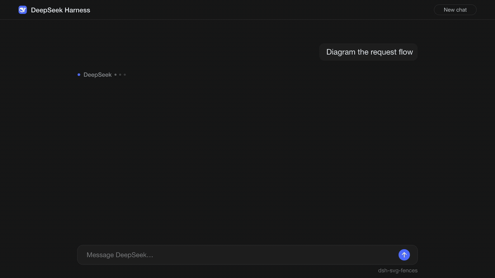
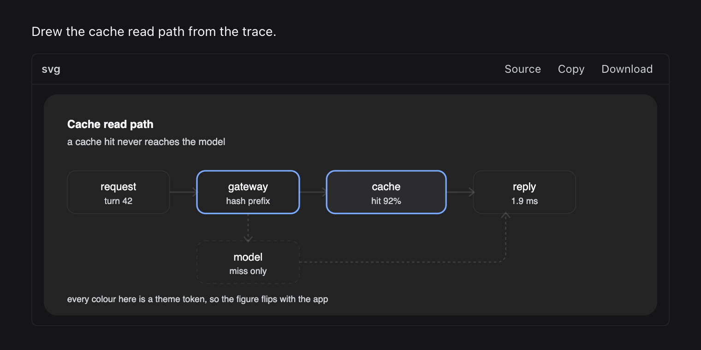
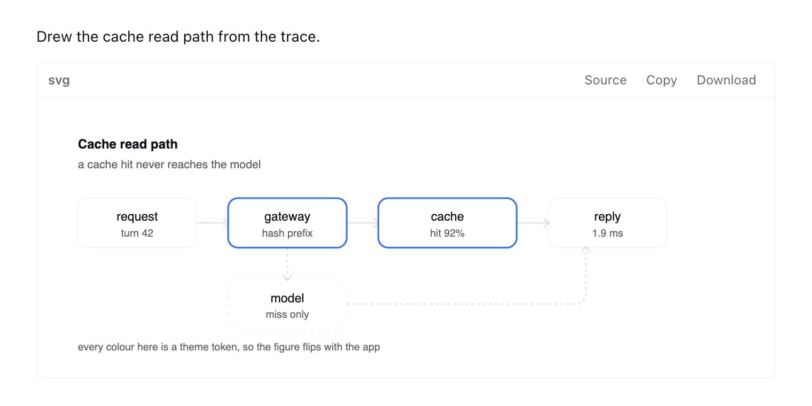

[English](https://github.com/chandra447/dsh-svg-fences/blob/main/README.md) | [中文](https://github.com/chandra447/dsh-svg-fences/blob/main/README.zh.md)

<p align="center">
  
</p>

<h1 align="center">dsh-svg-fences</h1>

<p align="center">
  <a href="https://www.npmjs.com/package/dsh-svg-fences"></a>
  <a href="LICENSE"></a>
  <a href="https://github.com/chandra447/dsh-svg-fences/actions/workflows/ci.yml"></a>
</p>

<p align="center">
  
</p>

**DeepSeek Harness 把 SVG 代码块当成代码显示。这个插件直接把图画出来。**

_25 fps 动画，由 fframes 渲染。[看 1080p MP4](assets/hero.mp4)。_


助手写了一段 SVG，DSH 给你看的是 40 行 XML。装上这个插件，你看到的是图本身，就在原来代码块的位置。想看 XML，点一下就回来了。

## 安装

在应用里打开 **Plugins** 窗口，进入 **Discover**，搜索 `dsh-svg-fences` 并安装。

用命令行的话，按你使用的 profile 选一行：

```sh
dsh plugin --profile web add dsh-svg-fences
dsh plugin --profile desktop add dsh-svg-fences
```

卸载时把 `add` 换成 `remove` 即可。

包里自带构建好的 `client.js`。安装时不运行任何构建脚本，所以 DSH 不会弹出构建审批（`allowBuilds`）。没有 host 端代码，没有依赖，整个插件只有大约 22 KB 的浏览器 JS。

已在 macOS 上的 DeepSeek Harness 0.2.x 中测试。包声明需要 Node 22.19 或更高版本。真正运行的部分是普通的浏览器 JS。其他平台尚未测试。

## 你会得到什么

- **图形取代代码块。** 图形显示期间，原来的代码块会隐藏起来。
- **一条小工具栏。** 左边是 `svg` 标签，右边是 `Source`、`Copy`、`Download`。
- **源码与渲染随时切换。** 点 `Source` 回到代码，同一个按钮变成 `Render`，再点一下回到图形。
- **复制**得到的是代码块原文，主题变量原样保留。
- **下载**保存为 `.svg` 文件，文件名取自图形的 `<title>`，没有的话就叫 `figure.svg`。
- **缩放。** 点击图形打开大图，带 `+`、`−` 和重置按钮。按 Escape 或点击背景即可关闭。
- **跟随主题。** 颜色跟着 DSH 的亮色和暗色主题走，大图开着的时候切换主题也一样。
- **看内容，不看标签。** 代码块标的是什么语言无所谓，只要内容是 SVG 文档，就会变成图形。
- **工具栏文字支持中英文，** 跟随 DSH 的界面语言。中文界面下显示为“源码”“渲染”“复制”“下载”。

## 主题变量

在代码块里用 CSS 变量写颜色。插件会在绘制前把每个变量换成当前主题的实际取值，主题一变就重新替换一次。

| SVG 里写 | 对应的 DSH token | 常见用途 |
| --- | --- | --- |
| `var(--fg)` | `--dsw-alias-label-primary` | 正文、主线条 |
| `var(--muted)` | `--dsw-alias-label-secondary` | 说明文字、次要线条 |
| `var(--accent)` | 蓝色强调色（`--dsw-alias-link`，带后备） | 需要突出的那一处 |
| `var(--bg)` | `--dsw-alias-bg-base` | 页面背景 |
| `var(--surface)` | `--dsw-alias-bg-layer-1` | 方框、卡片 |
| `var(--surface-alt)` | `--dsw-alias-bg-layer-2` | 嵌套方框、条纹 |
| `var(--border)` | `--dsw-alias-border-l1` | 方框描边 |
| `var(--line)` | `--dsw-alias-border-l2` | 连线、网格线 |
| `var(--dsw-...)` | 原样读取该 token | 主题里的其他任何值 |

三条小规则：

- `var(--name, #888)` 在 token 不存在时使用 `#888`。没写后备值的话，就用正文颜色。
- `currentColor` 跟随主题的正文颜色。只要你没在根 `<svg>` 上写 `color`，插件会替你补上。
- 根元素没设 `font-family` 时，默认字体是 `sans-serif`。

模型并不知道这些变量名，得你告诉它。在提示词或项目说明里加一句这样的话就有帮助：

```text
When you draw SVG, use var(--fg), var(--muted), var(--accent), var(--surface) and var(--border) for colors.
```

下面这个代码块在亮色和暗色主题下都会跟着变，下载下来的文件名是 `hello-figure.svg`：

````markdown
```svg
<svg viewBox="0 0 260 80" xmlns="http://www.w3.org/2000/svg">
  <title>hello-figure</title>
  <rect x="1" y="1" width="258" height="78" rx="10" fill="var(--surface)" stroke="var(--border)"/>
  <circle cx="40" cy="40" r="14" fill="var(--accent)"/>
  <text x="68" y="45" font-size="15" fill="var(--fg)">Rendered, not printed</text>
</svg>
```
````

| 暗色主题 | 亮色主题 |
| --- | --- |
|  |  |

## 可以一起用

- **Mermaid 插件。** Mermaid 源码以 `graph`、`sequenceDiagram` 这类关键字开头，不会以 `<svg` 开头，所以本插件不会碰这些代码块。两个一起装就好。
- **其他按语言认领代码块的插件。** 本插件只处理内容是 SVG 文档的代码块。

## 局限

下面这些是有意不做的：

- 不执行 SVG 里的任何东西。图形是一个 ``，来源是 `data:image/svg+xml`，所以脚本不会运行，链接点不了，外部图片和字体也不会加载。来路不明的代码块内容没法执行代码。
- 不联网。没有请求，没有 CDN，也不用下载渲染器。
- 不修改消息。图形只是叠在对话记录上的一层视图。停用插件，代码块就回来了。
- 不渲染 Mermaid、PlantUML、Graphviz 或其他图表语言，只认 SVG。
- 带行号的代码块会跳过。
- 解析失败的 SVG 会跳过。你看到的还是普通代码块，方便找出哪里写错了。
- 超过 60 KB 的源码会跳过。
- 下载的文件会把当前主题的颜色写死。复制得到的源码则保留 `var(--...)` 变量。

## 实现原理

- 一个 `MutationObserver` 监听页面。页面变化后 250 ms 内，它会扫描每个 `div.md-code-block`，读取其中 `<pre>` 的文本。
- 判定条件是文本去掉首尾空白后以 `<` 开头，并且 `DOMParser` 按 `image/svg+xml` 解析出 `<svg>` 根元素、没有 `parsererror`。DSH 把代码块的语言作为 React prop 保存，根本不会出现在 DOM 里，所以内容是唯一可靠的依据。
- 主题变量通过对代码块本身调用 `getComputedStyle` 读取，因为 DSH 把主题变量挂在各个容器上，而不是 `:root`。每个 `var(--name)` 都换成计算后的值，根元素缺少 `xmlns`、`color`、`font-family` 时会补上。
- 处理后的结果编码成 `data:image/svg+xml` URI，放进代码块后面的一个 ``。原代码块通过一个 data 属性配合 CSS 隐藏。图片加载失败的话，代码块会恢复显示。
- 第二个 observer 监听 `<html>` 和 `<body>` 的属性变化，DSH 就是在这里设置 `data-ds-dark-theme` 的。解析出的配色一变，所有图形都会重新编码。

## 同系列插件

[dsh-table-charts](https://github.com/chandra447/dsh-table-charts/blob/main/README.zh.md) 会在看起来像数据的 Markdown 表格下面画一张条形图。做法相同，也是一个预构建的 `client.js`，没有依赖，不需要服务。

## 致谢

思路来自 [oh-my-pi](https://github.com/can1357/oh-my-pi) 的图形管线。它把 SVG 代码块从助手的 markdown 中提取出来，在栅格化之前解析主题 token，提供源码切换，还能把表格变成图表。本插件是把这些思路移植到 DSH 浏览器端的实现，代码从零写起，没有使用 oh-my-pi 的代码。

开头的动画用 [fframes](https://github.com/dmtrKovalenko/fframes) 渲染，这是一个基于 Rust 和 SVG 的视频渲染器。截图是插件在 DSH 样式下的真实渲染结果。

演示里的 DeepSeek 鲸鱼图标来自 [LobeHub Icons](https://github.com/lobehub/lobe-icons)（MIT）。DeepSeek 及其标志是 DeepSeek 的商标。详见 [第三方声明](THIRD-PARTY.md)。

## 许可证

[MIT](LICENSE) © Chandra Doredla
